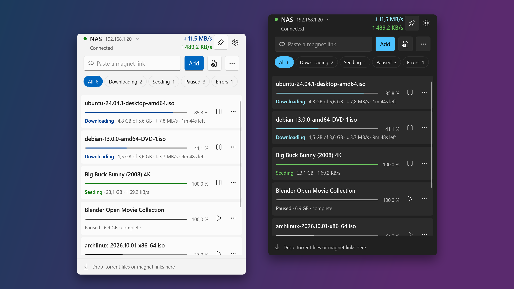

# Torray

A Windows 11 tray flyout for a remote [Transmission](https://transmissionbt.com/) daemon.
Check progress, add torrents, and pause or remove them without opening a web UI.



## Install

Download `TorrayApp-win-Setup.exe` from the [latest release](https://github.com/Diddlik/Torray/releases/latest) and run it.
No admin rights are needed. Torray updates itself from GitHub Releases.
The installer is not code-signed yet, so Windows SmartScreen shows a warning.

On first start, click the tray icon and choose **Set up connection**.

## Features

- **Live list:** status, progress, rates, and time left for every torrent, with filters for downloading, seeding, paused,
  and errors. Refreshes every 2 s while open and every 20 s while hidden.
- **Add torrents:** paste a magnet link, pick `.torrent` files, or drop either onto the panel.
  The options button sets a download folder on the server and whether to add paused.
- **Row actions:** pause or resume with one click. The **⋯** menu has details (trackers, peers, ratio), copy name,
  **Remove from list** (keeps the files), and **Remove and delete data…** (always asks first).
- **Several servers:** switch with the arrow next to the server name. Each server keeps its own password.
- **Watch folders:** new `.torrent` files in chosen folders are uploaded once fully written, retried when the server is
  unreachable, and optionally moved to an `Added` subfolder.
- **Notifications** when a download finishes or a torrent reports an error.
- **Keyboard:** `Ctrl+Alt+T` shows or hides the panel from anywhere. In the list, Space pauses or resumes, Delete removes,
  Shift+Delete deletes with data, and the menu key opens the row menu. Esc hides the panel.
- **Pin** keeps the panel open while you work in other windows.
- Light and dark mode follow Windows.

## Transmission compatibility

Transmission 4.0 and newer. Torray detects the protocol automatically: legacy RPC for 4.0, JSON-RPC 2.0 for 4.1+.
Tested with Transmission 4.0.6 and 4.1.3, including a server with 1,200 torrents.

Keep RPC reachable only on a trusted LAN, a VPN, or behind an HTTPS reverse proxy with authentication.

## Data locations

- Settings and server profiles: `%LOCALAPPDATA%\Torray\settings.json`
- Passwords: `%LOCALAPPDATA%\Torray\secrets\`, encrypted with Windows DPAPI for the current user, never in settings or logs
- Logs: `%LOCALAPPDATA%\Torray\logs\` (daily files, 14 kept, 10 MB maximum each)

## Development

Requires Windows 11 x64 and the .NET 10 SDK.

```powershell
dotnet build Torray.slnx
dotnet test Torray.slnx
dotnet run --project src/Torray.App
./scripts/pack.ps1   # local installer in artifacts/releases
```

To release, set `<Version>` in `Directory.Build.props`, commit, and push a matching tag such as `v0.7.0`.
The release workflow builds the installer and publishes the GitHub release that installed copies update from.

See [REQUIREMENTS.md](REQUIREMENTS.md) for the full specification. Not implemented yet (spec P1): a drop target on the
tray icon, a clipboard magnet helper, file selection and priorities, per-torrent speed limits, search and multi-select,
and daemon-to-Windows path mapping.

## License

MIT. See [LICENSE](LICENSE).
